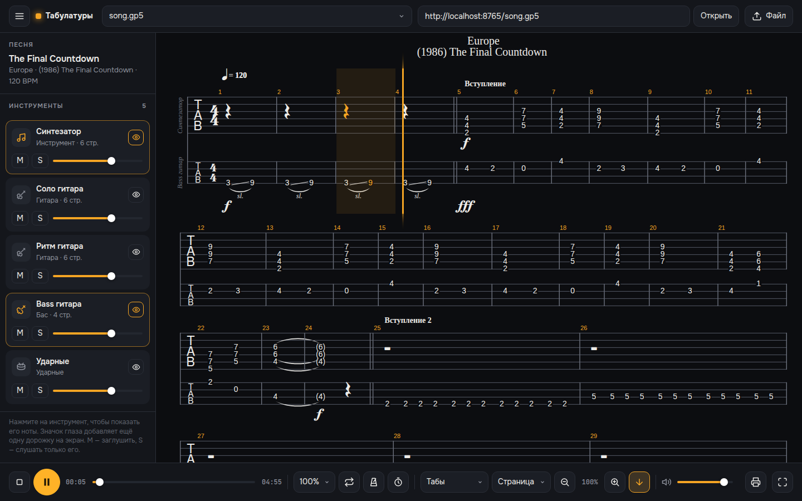
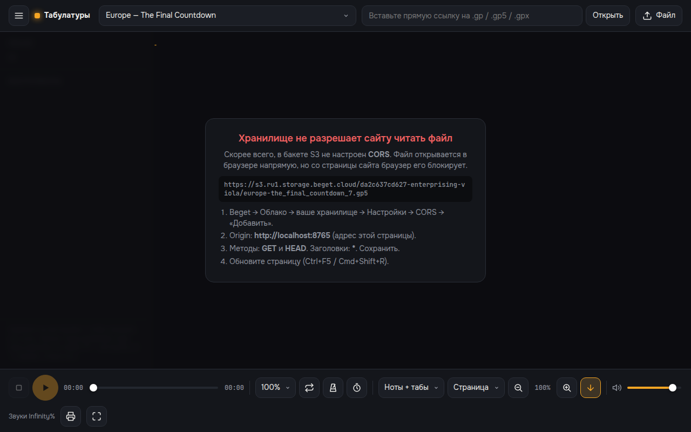

# Плеер табулатур для Tilda

Тёмный плеер табулатур Guitar Pro для сайта на Tilda. Работает на движке [alphaTab](https://www.alphatab.net/) 1.8.4. Файлы `.gp`, `.gpx`, `.gp5`, `.gp4`, `.gp3` и MusicXML загружаются по прямым ссылкам из S3-хранилища, например Beget.



## Возможности

- **Ноты и табы.** Показывает табы, ноты + табы или только ноты. Есть раскладка «Страница» и «Лента».
- **Инструменты.** Каждую дорожку можно показать на экране, заглушить (M), включить соло (S) и настроить её громкость. Значок глаза выводит несколько дорожек сразу.
- **Воспроизведение.** Есть кнопки «Играть», «Пауза» и «Стоп», полоса перемотки и время. Клик по нотам переносит курсор в это место.
- **Для занятий.** Скорость от 25 до 150 %, метроном, отсчёт перед началом и повтор. Если выделить такты мышкой, повторяться будет только выделенный фрагмент.
- **Удобство.** Курсор подсвечивает ноты, а экран прокручивается за ним. Есть масштаб, печать в PDF, полноэкранный режим и общая громкость. Пробел запускает и ставит на паузу.
- **Источники файлов.** Песни берутся из списка в коде, из файла `songs.json` в S3, из ссылки, вставленной в поле, или из файла с компьютера. Файл также можно перетащить на ноты.
- **Русские названия.** Названия в старых файлах `.gp3`–`.gp5` отображаются правильно, потому что включена кодировка Windows-1251.
- **Понятные ошибки.** Если хранилище блокирует файл, плеер объясняет, что нужно сделать. Таких ошибок три: не настроен CORS, нет доступа (403) или файл не найден (404).
- **Телефоны.** Интерфейс подстраивается под экран, а список инструментов открывается кнопкой ☰.

## Файлы

| Файл | Что это |
|---|---|
| `tilda-embed.html` | **Код для Tilda.** Скопируйте его целиком в блок T123. |
| `index.html` | Тот же плеер в виде отдельной страницы для GitHub Pages и проверки. |
| `songs.example.json` | Пример списка песен, если хотите хранить его в S3, а не в коде. |
| `build.sh` | Собирает `index.html` из `tilda-embed.html`. |

## Шаг 1. Настройте S3 (Beget)

Без этого шага плеер не сможет прочитать файл. Браузер открывает ссылку напрямую, но страница сайта получает файл только с разрешения хранилища. Это разрешение называется CORS.

1. Загрузите файлы в бакет. Имена лучше писать латиницей без пробелов, например `final_countdown.gp5`.
2. Включите публичный доступ на чтение. Чтобы проверить его, откройте ссылку на файл в режиме инкогнито: файл должен скачаться.
3. Откройте **Beget → Облако → ваше хранилище → Настройки → CORS → «Добавить»** и заполните поля:
   - **Origin:** адрес сайта с `https://` и без `/` на конце, например `https://ваш-сайт.ru`. Для каждого адреса добавьте отдельное правило:
     - `https://www.ваш-сайт.ru`, если сайт открывается и с `www`;
     - `https://ваш-проект.tilda.ws`, если сайт работает на поддомене Tilda;
     - `https://inciferm.github.io`, если нужна демо-страница на GitHub.
   - **Методы:** `GET` и `HEAD`.
   - **Заголовки:** `*`.
4. Сохраните правило и обновите страницу с очисткой кэша: Ctrl+F5 в Windows или Cmd+Shift+R на Mac.

Как проверить: если в плеере появилось окно «Хранилище не разрешает сайту читать файл», CORS ещё не настроен. Возможно, в Origin указан не тот адрес. Плеер показывает в этом окне точный адрес, который нужно вписать.



## Шаг 2. Вставьте ссылки на файлы

В самом начале `tilda-embed.html` находится блок настроек:

```js
window.TAB_PLAYER_CONFIG = {
  songs: [
    { title: 'Europe — The Final Countdown', url: 'https://s3.ru1.storage.beget.cloud/БАКЕТ/europe-the_final_countdown_7.gp5' },
    { title: 'Вторая песня',                 url: 'https://s3.ru1.storage.beget.cloud/БАКЕТ/song2.gp' }
  ],
  songsJsonUrl: '',          // ссылка на songs.json в S3 (необязательно)
  encoding: 'windows-1251',  // кодировка старых .gp3–.gp5 (русские названия)
  height: '100vh',           // высота плеера: '100vh' = весь экран, или '800px'
  accent: '#f5a524',         // акцентный цвет
  allowLocalFiles: true,     // кнопка «Файл»
  allowUrlInput: true        // поле «Вставьте ссылку»
};
```

- `title` — название песни в выпадающем списке.
- `url` — прямая ссылка на файл в S3. Её можно скопировать в файловом менеджере Beget.
- Каждая песня записывается на отдельной строке в фигурных скобках `{ ... }`. Строки разделяются запятой. После последней строки запятая не нужна.

Список песен можно хранить в S3, а не в коде. Загрузите в бакет файл `songs.json` в формате `songs.example.json`. Затем укажите его адрес в `songsJsonUrl`. После этого новые песни добавляются только в этот файл, а код на Tilda трогать не нужно.

Открыть конкретную песню можно и по ссылке на страницу: `https://ваш-сайт.ru/tabs?tab=https://s3.ru1.storage.beget.cloud/БАКЕТ/song.gp5`.

## Шаг 3. Вставьте плеер на Tilda

1. Добавьте на страницу блок **T123 «HTML-код»** из раздела «Другое».
2. Скопируйте **всё** содержимое файла [`tilda-embed.html`](tilda-embed.html). Нажмите на нём кнопку Raw, затем Ctrl+A и Ctrl+C.
3. Вставьте код в блок и сохраните.
4. Нажмите **«Опубликовать»** и проверяйте опубликованную страницу. В режиме предпросмотра скрипты Tilda могут не работать.

Плеер занимает всю ширину блока и по умолчанию всю высоту экрана. Чтобы сделать его ниже, задайте `height: '800px'`.

## Частые проблемы

| Что видно | Причина и решение |
|---|---|
| «Хранилище не разрешает сайту читать файл» | Не настроен CORS (шаг 1, пункт 3), или в Origin не тот адрес. |
| «Доступ запрещён (403)» | Бакет или файл закрыт. Включите публичное чтение. |
| «Файл не найден (404)» | В ссылке ошибка. Проверьте имя файла и регистр букв. |
| Вместо русских названий «������» | Файл сохранён не в Windows-1251. Попробуйте `encoding: 'utf-8'`. |
| Нет звука на телефоне | Нажмите «Играть» вручную и выключите беззвучный режим на iPhone. |
| Долго появляется кнопка «Играть» | При первом открытии загружаются звуки (около 1,3 МБ). Справа над панелью виден процент загрузки. |

## Демо-страница на GitHub Pages

Включите её так: **Settings → Pages → Source: Deploy from a branch → `main` / `(root)`**. Страница будет доступна по адресу `https://inciferm.github.io/tab-player/`. Чтобы она могла читать файлы из бакета, добавьте `https://inciferm.github.io` в CORS.

## Для разработчика

- Движок подключается с jsDelivr. Версия закреплена: `@coderline/alphatab@1.8.4`.
- Файл загружается через `fetch`, а затем передаётся в `api.load(Uint8Array)`. Поэтому плеер может различить ошибки CORS, 403 и 404.
- Объект плеера доступен в консоли браузера как `window.tabPlayer`.
- После правок в `tilda-embed.html` запустите `./build.sh`, чтобы обновить `index.html`.

Лицензия alphaTab — MPL-2.0. Звуки — SoundFont Sonivox из пакета alphaTab.
